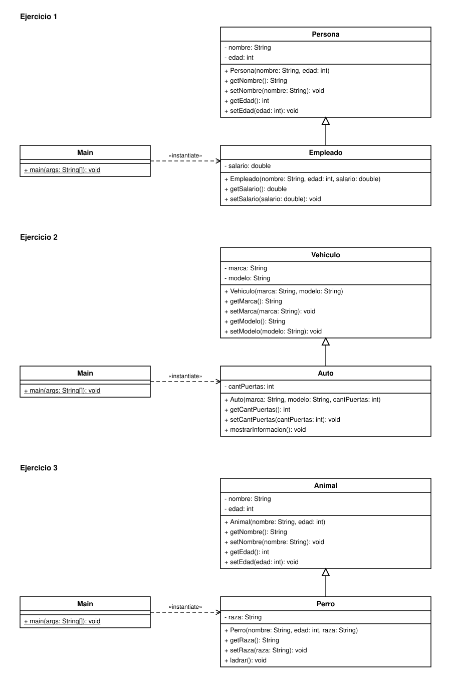

# TP Herencia simple (Java)

Trabajo práctico de Programación Orientada a Objetos: herencia simple entre clases.

## Estructura

    src/
      ejercicio1/   Persona, Empleado, Main
      ejercicio2/   Vehiculo, Auto, Main
      ejercicio3/   Animal, Perro, Main
    docs/
      uml-herencia.drawio   diagrama editable en draw.io
      uml-herencia.svg      diagrama para visualizar

## Ejercicios

1. **Persona y Empleado**: Persona tiene nombre y edad privados; Empleado hereda de Persona y agrega salario. Ambas con constructor y get/set. El Main muestra todos los datos del Empleado.
2. **Vehiculo y Auto**: Vehiculo tiene marca y modelo privados; Auto hereda de Vehiculo y agrega cantPuertas. Ambas con constructor y get/set. El Main crea un Auto y muestra su información con el método mostrarInformacion().
3. **Animal y Perro**: Animal tiene nombre y edad privados; Perro hereda de Animal y agrega raza, además del método ladrar() que muestra el mensaje el perro está ladrando. El Main crea un Perro y ejecuta ladrar().
4. **Diagramas UML** de cada punto en la carpeta docs.

## Cómo ejecutarlo

Desde la raíz del repositorio (Java 11 o superior):

    javac -d out src/*/*.java
    java -cp out ejercicio1.Main

Cambiar ejercicio1 por ejercicio2 o ejercicio3 para correr cada uno.

## Diagrama UML

